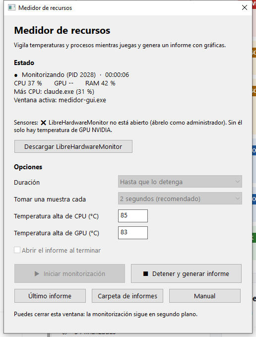

# Medidor de recursos

Monitor ligero para Windows, escrito en Rust, que ayuda a averiguar **por qué un PC tiene bajadas de FPS**: ¿se calienta?, ¿hay un proceso en segundo plano que se come la CPU?, ¿se llena la RAM?

Se inicia desde una **ventana sencilla** (o desde la consola), se deja funcionando en segundo plano mientras se juega y al terminar genera un **informe HTML con gráficas interactivas y un diagnóstico automático**, además de un CSV con todas las muestras.



- Dos ejecutables de ~850 KB, sin instalación ni dependencias: `medidor-gui.exe` (ventana) y `medidor-recursos.exe` (consola).
- Consumo medido del monitor: **~0,5 % de CPU y ~15 MB de RAM**, con prioridad de proceso baja. La ventana ocupa ~13 MB y se puede cerrar sin detener la monitorización.
- El informe es un único archivo HTML que funciona sin internet.

## Qué mide y qué te dice

Cada 2 segundos (configurable) registra:

| Dato | Fuente |
|---|---|
| Uso de CPU, RAM y disco (lectura/escritura) | Windows (crate `sysinfo`) |
| Procesos: CPU, RAM y disco, agrupados por nombre de ejecutable | Windows |
| Ventana activa (primer plano), normalmente el juego | API Win32 |
| Temperatura, frecuencia y consumo de CPU | LibreHardwareMonitor (WMI) |
| Temperatura, *hot spot*, uso, frecuencia, consumo y VRAM de GPU | LibreHardwareMonitor, o el driver NVIDIA (NVML) |
| Temperatura de discos y placa base | LibreHardwareMonitor |

El informe incluye:

- **Diagnóstico** ordenado por gravedad: temperatura crítica o alta, posible *thermal throttling*, CPU al 100 % y quién la ocupa, RAM llena, procesos en segundo plano con consumo sostenido, picos repentinos de CPU y mucha actividad de disco. Los procesos habituales (Defender, Windows Update, navegadores, launchers, overlays…) traen una explicación y qué hacer.
- **Gráficas** de temperaturas, uso, frecuencias, consumo eléctrico y disco. Al pasar el ratón se ve la hora, los valores, la ventana activa y los 5 procesos que más CPU usaban en ese instante. Los episodios de calor y de CPU saturada salen sombreados.
- **Episodios**: cada vez que hubo calor, CPU saturada o RAM llena: inicio, duración, máximo y los procesos responsables.
- **Tablas** de procesos (consumo medio, máximo, en segundo plano, RAM y disco), picos de CPU en segundo plano, ventanas activas y procesos con más memoria.

Hay un informe de ejemplo con datos simulados en [`ejemplo/informe_ejemplo.html`](ejemplo/informe_ejemplo.html) (descárgalo y ábrelo con el navegador; GitHub no renderiza HTML).

## Instalación

### Opción A: descargar el ejecutable

1. Ve a [Releases](../../releases) y descarga `medidor-recursos-windows.zip`.
2. Descomprímelo en cualquier carpeta.
3. Abre **`medidor-gui.exe`**. La primera vez, Windows SmartScreen puede avisar porque el exe no está firmado: *Más información → Ejecutar de todas formas*.

### Opción B: compilar desde el código

Requisitos: Windows 10/11 y [Rust](https://rustup.rs) (toolchain MSVC, la predeterminada en Windows).

```bash
git clone https://github.com/borjajoart/medidor-recursos.git
```

```bash
cd medidor-recursos
```

```bash
cargo build --release
```

Se generan dos ejecutables en `target\release\`: `medidor-gui.exe` (interfaz) y `medidor-recursos.exe` (consola). Cópialos a la carpeta [`distribuir`](distribuir), junto al manual, y esa carpeta ya está lista para usar o pasar a otra persona. `build.rs` incrusta en la interfaz el manifiesto de Windows (`res/medidor-gui.manifest`), necesario para que arranque.

### Temperaturas: LibreHardwareMonitor (recomendado)

Windows no da las temperaturas reales a programas normales. Para tenerlas:

1. Descarga [LibreHardwareMonitor](https://github.com/LibreHardwareMonitor/LibreHardwareMonitor/releases) y descomprímelo.
2. Ábrelo con **clic derecho → Ejecutar como administrador** y déjalo abierto (puede estar minimizado).
3. Inicia el medidor. Si abres LibreHardwareMonitor después, el medidor lo detecta en menos de 30 s.

Sin él, todo lo demás funciona; la GPU solo se lee si es NVIDIA (ver [Limitaciones](#limitaciones)).

## Probarlo

**1. Con la interfaz (lo normal):**

1. Abre `medidor-gui.exe`.
2. Elige **Duración: 15 minutos** (o déjalo en «Hasta que lo detenga») y pulsa **Iniciar monitorización**.
3. En **Estado** debe aparecer «Monitorizando» y, cada pocos segundos, el uso de CPU/GPU/RAM, el proceso que más consume y la ventana activa. En **Sensores** se ve si LibreHardwareMonitor está detectado.
4. Abre algo pesado (un juego, un benchmark, un vídeo 4K…) para ver cómo reacciona. Puedes cerrar la ventana: el monitor sigue funcionando.
5. Vuelve a abrir `medidor-gui.exe` y pulsa **Detener y generar informe**. El informe se abre en el navegador y queda en la carpeta `informes` (botones **Último informe** y **Carpeta de informes**).

En la cabecera del informe, la línea **«Sensores»** indica qué fuentes de temperatura se han usado; si pone «ninguna», LibreHardwareMonitor no estaba abierto o no estaba como administrador.

**2. Con la consola (prueba de 1 minuto):**

```bash
medidor-recursos.exe --duracion 1m --intervalo 1
```

Muestra una línea en directo (`CPU 23% 61°C | GPU 40% 55°C | RAM 48% | proceso top`) y al terminar abre el informe. Para el modo segundo plano:

```bash
medidor-recursos.exe --segundo-plano
```

```bash
medidor-recursos.exe estado
```

```bash
medidor-recursos.exe detener
```

La interfaz y la consola comparten el mismo monitor: se puede iniciar en una y detener en la otra.

**3. Tests y el informe de ejemplo:**

```bash
cargo test
```

Comprueba el análisis de argumentos y genera `ejemplo/informe_ejemplo.html` con una sesión simulada: juego que calienta la CPU hasta 102 °C con throttling y un análisis del antivirus en segundo plano. Sirve para ver todas las secciones del informe sin necesidad de tener sensores.

## Uso

Desde la interfaz, todo está en la ventana: duración, intervalo, umbrales de temperatura, iniciar/detener, abrir el último informe, la carpeta de informes y el manual.

Desde la consola:

```text
medidor-recursos [opciones]     Monitoriza hasta Ctrl+C (o hasta --duracion)
medidor-recursos detener        Detiene el monitor en segundo plano
medidor-recursos estado         Indica si hay un monitor en marcha

-d, --duracion <t>     90s, 30m, 2h, 1h30m (número solo = minutos)
-i, --intervalo <s>    Segundos entre muestras (por defecto 2)
-o, --salida <dir>     Carpeta de informes (por defecto 'informes' junto al .exe)
    --umbral-cpu <°C>  Temperatura de CPU considerada alta (85)
    --umbral-gpu <°C>  Temperatura de GPU considerada alta (83)
-b, --segundo-plano    Sin ventana; se para con 'detener'
    --no-abrir         No abrir el informe al terminar
```

El manual completo para usuarios no técnicos (cómo leer el informe y qué hacer según el resultado) está en [`distribuir/MANUAL.md`](distribuir/MANUAL.md).

## Limitaciones

Conviene tenerlas en cuenta al interpretar un informe:

- **Solo Windows.** Usa WMI y la API Win32 (ventana activa, prioridad, procesos desacoplados).
- **Temperaturas dependientes de LibreHardwareMonitor.** Sin él:
  - GPU NVIDIA: se lee del driver (NVML).
  - GPU AMD/Intel: sin datos.
  - CPU: solo la zona térmica ACPI, que requiere administrador y en sobremesa suele ser un valor fijo sin sentido (el informe lo avisa).
- **Validación de sensores pendiente.** La lectura vía LibreHardwareMonitor y NVML está implementada, pero se ha desarrollado en un equipo sin ellos (Intel i5-6500 + Radeon RX 560, sin LibreHardwareMonitor). Los nombres de los sensores varían entre placas, CPUs y versiones de LibreHardwareMonitor, así que en algún hardware puede faltar algún valor (p. ej. consumo o frecuencia). Si pasa, abre un issue con una captura de LibreHardwareMonitor.
- **No mide FPS ni frametimes.** Eso requiere ETW/PresentMon. La forma de cruzarlo es apuntar la hora de la bajada y buscarla en las gráficas, o usar a la vez el overlay de Steam/NVIDIA/AMD.
- **Sin uso de GPU por proceso.** El uso de GPU es global; en los episodios de calor de la GPU se muestra la ventana activa como probable responsable, no una medición por proceso.
- **Una sola GPU.** Si hay varias, se elige la dedicada (NVIDIA > AMD > Intel); con NVML, la GPU 0.
- **Resolución temporal.** Con el intervalo de 2 s, picos de menos de 2 s se promedian o no se ven. Se puede bajar a `--intervalo 0.5` a cambio de algo más de consumo.
- **Atribución aproximada.** Los responsables de cada episodio salen del top 5 de procesos de cada muestra: procesos pequeños no aparecen y los de mismo nombre se suman (todos los `svchost.exe` juntos, todas las pestañas de `chrome.exe` juntas).
- **Throttling de CPU por heurística.** Se marca cuando la frecuencia cae más de un 20 % respecto a su P95 con carga ≥ 50 % y temperatura cerca del umbral. Necesita las frecuencias de LibreHardwareMonitor; puede no detectar límites de potencia (PL1/PL2) y dar falsos positivos con planes de ahorro de energía. En NVIDIA se usa además el motivo de throttling que informa el driver.
- **«Segundo plano» significa «no es la ventana activa».** Con un segundo monitor o haciendo alt-tab, la clasificación puede no coincidir con lo que el usuario considera el juego.
- **Procesos protegidos.** Sin permisos de administrador, Windows no deja leer todos los datos (sobre todo disco) de algunos procesos del sistema.
- **Guardado.** El CSV se escribe en cada muestra, pero el HTML se regenera cada 5 minutos y al terminar: si el proceso se mata a la fuerza, el informe puede no incluir los últimos minutos (el CSV sí).
- **Sesiones largas.** Las gráficas se reducen a 2000 puntos conservando los picos; el análisis y el CSV usan todas las muestras. Varias horas generan un HTML de pocos MB.
- **Un monitor a la vez.** Los archivos de control (`medidor-recursos.pid` / `.stop`) están en `%TEMP%`.
- **Ejecutable sin firma.** SmartScreen y algunos antivirus pueden avisar la primera vez.
- **Interfaz básica.** Ventana Win32 de tamaño fijo, sin icono propio ni icono en la bandeja del sistema: para ver el estado o detener hay que volver a abrir `medidor-gui.exe`. Los datos en directo se leen del CSV del monitor, así que se actualizan al ritmo del intervalo elegido. El botón **Manual** abre `MANUAL.md` en el Bloc de notas (sin formato).

## Estructura del proyecto

```text
src/
  lib.rs             Librería compartida por los dos ejecutables
  cli.rs             Opciones y análisis de argumentos
  monitor.rs         Bucle de muestreo, procesos, picos, CSV, control en segundo plano (detener/estado)
  sensors.rs         LibreHardwareMonitor/OpenHardwareMonitor (WMI), NVIDIA NVML, ACPI
  report.rs          Análisis (episodios, throttling, culpables, diagnóstico) y HTML
  informe.html       Plantilla del informe (CSS + JS de las gráficas, sin dependencias)
  main.rs            Ejecutable de consola (medidor-recursos.exe)
  bin/medidor-gui.rs Interfaz gráfica nativa Win32 (medidor-gui.exe), con native-windows-gui
res/                 Manifiesto de Windows de la interfaz (controles comunes v6, DPI)
build.rs             Incrusta el manifiesto al compilar
distribuir/          Carpeta para usuarios: MANUAL.md y captura (los .exe van en Releases)
ejemplo/             Informe de ejemplo generado por `cargo test`
```

## Licencia

[MIT](LICENSE).
