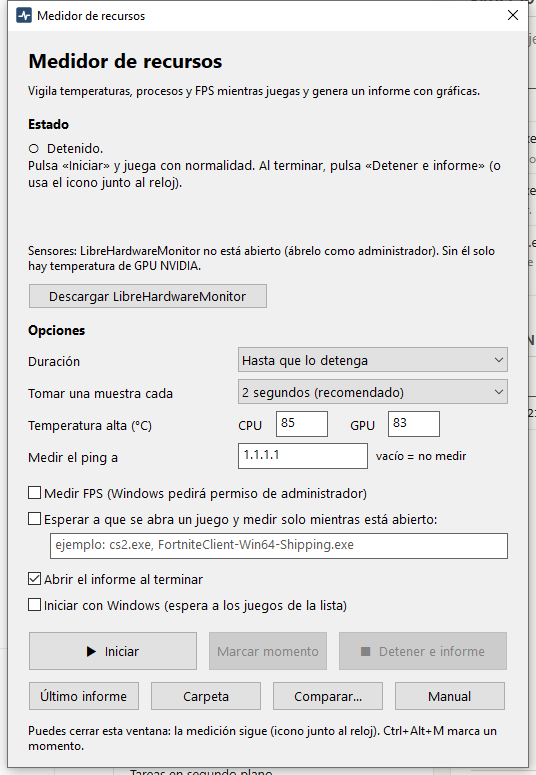

# Medidor de recursos: manual de uso

Programa pequeño (sin instalación) que vigila el PC mientras juegas y al terminar genera un **informe con gráficas** que responde a:

- ¿Bajan los FPS? ¿Cuándo, cuánto y qué estaba pasando en ese momento?
- ¿Qué temperatura alcanzan la **CPU** y la **GPU**? ¿Se frenan por calor (*thermal throttling*)?
- ¿Hay **programas en segundo plano** (antivirus, Windows Update, navegador, Discord, launchers…) gastando CPU o GPU mientras juegas?
- ¿Se llena la **RAM** o la memoria de la gráfica (**VRAM**)? ¿El **disco** está muy ocupado? ¿Hay **picos de ping**?

Gasta muy poco (alrededor del 0,5 % de CPU y 18 MB de RAM) y funciona con prioridad baja para no quitarle recursos al juego.

---

## 1. Antes de empezar

### Temperaturas: LibreHardwareMonitor (recomendado)

Windows no da las temperaturas reales a los programas normales. El medidor las lee a través de **LibreHardwareMonitor**, gratuito y de código abierto.

1. Descárgalo de su página de GitHub (botón **Descargar LibreHardwareMonitor** del programa) y descomprímelo, por ejemplo en `C:\LibreHardwareMonitor`.
2. Abre `LibreHardwareMonitor.exe` con **clic derecho → Ejecutar como administrador**.
3. **Déjalo abierto** (minimizado vale) mientras usas el medidor.

Para no tener que acordarte: en LibreHardwareMonitor activa *Options → Start Minimized*, *Minimize To Tray* y *Run On Windows Startup*.

Sin LibreHardwareMonitor el medidor funciona igual para procesos, FPS, CPU, RAM, disco y red. La GPU solo tendrá temperatura si es NVIDIA, y la de la CPU casi nunca.

### FPS: permiso de administrador

Windows solo deja leer los FPS a programas con permiso de administrador. Si marcas **Medir FPS**, al pulsar Iniciar saldrá el aviso de Windows «¿Quieres permitir que esta aplicación haga cambios?»: pulsa **Sí**. Si dices que no, se mide todo lo demás.

Los FPS funcionan con juegos DirectX (la gran mayoría). Con juegos Vulkan u OpenGL no salen.

---

## 2. La ventana del programa

Abre **`medidor-gui.exe`** con doble clic.



- **Estado**: si está midiendo, el tiempo, los FPS, el uso y la temperatura de CPU y GPU, la RAM, el proceso que más CPU gasta y la ventana activa.
- **Sensores**: si LibreHardwareMonitor está abierto.
- **Opciones** (se recuerdan para la próxima vez):
  - **Duración**: hasta que lo detengas, o de 15 min a 4 h.
  - **Tomar una muestra cada**: 1, 2 (recomendado) o 5 segundos.
  - **Temperatura alta**: a partir de cuántos grados se considera que la CPU o la GPU se calientan (85 y 83 °C).
  - **Medir el ping a**: servidor al que se hace ping (1.1.1.1 por defecto). Vacío = no medir. Si juegas siempre en el mismo servidor y conoces su IP, puedes ponerla.
  - **Medir FPS**: ver arriba.
  - **Esperar a que se abra un juego**: escribe el nombre del ejecutable del juego (por ejemplo `cs2.exe`; varios separados por comas). No mide nada hasta que lo abres y para solo al cerrarlo. Un informe por partida. El nombre exacto se ve en el Administrador de tareas → pestaña *Detalles*.
  - **Abrir el informe al terminar**.
  - **Iniciar con Windows**: al iniciar sesión se queda esperando a los juegos de la lista (necesita la opción anterior).
- **Iniciar** / **Marcar momento** / **Detener e informe**.
- **Último informe**, **Carpeta** (la de los informes), **Comparar...** (ver apartado 5) y **Manual**.

### El icono junto al reloj

Mientras mide aparece un icono junto al reloj de Windows (puede estar dentro de la flecha ^):

- **Gris**: esperando a que abras el juego.
- **Verde**: midiendo, temperaturas normales.
- **Naranja**: a menos de 8 °C del límite.
- **Rojo**: por encima del límite.

Al pasar el ratón muestra el tiempo, las temperaturas y los FPS. Con clic derecho: **Marcar este momento**, **Abrir el panel** y **Detener y generar informe**.

Si pasa algo raro durante la partida (CPU o GPU muy calientes, RAM o VRAM llenas, un programa que se dispara en segundo plano) sale un aviso de Windows. En juegos a pantalla completa Windows los guarda para después en el Centro de actividades.

### Marcar momentos: Ctrl+Alt+M

Cuando notes un tirón o una bajada, pulsa **Ctrl+Alt+M**, también dentro del juego. Suena un pitido corto y queda una marca. En el informe verás cada marca en las gráficas y una tabla con lo que pasaba en ese instante. Es la forma más fácil de cazar el problema.

### Flujo típico

1. Abre LibreHardwareMonitor (como administrador).
2. Abre `medidor-gui.exe`, marca **Medir FPS** y pulsa **Iniciar**. Puedes cerrar la ventana.
3. Juega como siempre, al menos 30–60 minutos. Pulsa **Ctrl+Alt+M** cada vez que notes una bajada.
4. Al terminar, clic derecho en el icono → **Detener y generar informe**. El informe se abre en el navegador.

Los informes se guardan en la carpeta **`informes`**, junto al programa. Si el PC se apaga o el programa se cierra a la fuerza, el informe se guarda solo cada 5 minutos y el CSV en cada muestra.

---

## 3. Cómo leer el informe

**Resumen.** Dos o tres frases con lo más importante y una tabla con los datos clave: FPS medios y 1 % low, temperaturas máximas, uso de CPU, RAM, ping, la aplicación principal y los sensores usados. Si en «Sensores» pone «ninguna», LibreHardwareMonitor no estaba abierto como administrador.

**Hallazgos.** Lista numerada, de lo más grave a lo menos. El color del número indica la gravedad: rojo = grave, naranja = aviso, azul = dato útil, verde = correcto. Muchos procesos conocidos traen una explicación (por ejemplo, `MsMpEng.exe` es el análisis del antivirus Defender).

**Línea de tiempo.** Las gráficas comparten el eje de tiempo: al pasar el ratón por una, el cursor se mueve en todas y aparece un recuadro con la hora, los valores, la ventana activa y los procesos que más CPU y GPU usaban en ese instante.

- **FPS**: la línea normal son los FPS medios de cada intervalo y la fina el 1 % low (los fotogramas más lentos). Las zonas sombreadas son caídas.
- Las zonas sombreadas en el resto marcan episodios: calor de CPU o GPU, CPU saturada.
- Las líneas verticales con número son tus marcas.
- Las líneas discontinuas horizontales son los límites de temperatura.
- En **Frecuencias**: si la línea baja justo cuando la temperatura está arriba, es *throttling*.
- En **Ventiladores**: las revoluciones de cada ventilador que detecta LibreHardwareMonitor.

**Marcas.** Cada marca con su hora, si coincide con una caída de FPS y qué pasaba.

**Caídas de FPS.** Cada caída con la hora, la duración, el mínimo y lo que coincidía (otro programa usando la GPU, un pico de CPU, throttling, VRAM llena, disco…). Si no aparece ninguna causa, lo más probable es que sea el propio juego (carga de zona, *shader compilation*) o algo que el medidor no ve.

**Episodios de temperatura y carga.** Cada vez que hubo calor, CPU saturada o RAM llena: cuándo, cuánto duró, el máximo y los procesos que más CPU usaron.

**Procesos.** Consumo medio y máximo de CPU, CPU en segundo plano (cuando no eran la ventana activa), GPU, RAM y disco. `×14` indica 14 procesos con ese nombre (típico de navegadores).

**Picos en segundo plano.** Procesos que, sin ser la ventana activa, superaron el 15 % de la CPU. Son los primeros sospechosos de tirones.

---

## 4. Qué hacer según el resultado

| Lo que ves | Causa probable | Qué hacer |
|---|---|---|
| CPU > 85–90 °C o «throttling» | Refrigeración insuficiente | Limpiar polvo del disipador y ventiladores, cambiar la pasta térmica si tiene años, mejorar el flujo de aire, revisar la curva de ventiladores en la BIOS. |
| GPU > 83–85 °C o «GPU limitada» | Gráfica sucia o caja mal ventilada | Limpiar los ventiladores de la gráfica, curva de ventilador más agresiva (MSI Afterburner / AMD Adrenalin), limitar FPS. |
| Ventilador a 0 rpm con temperatura alta | Ventilador parado o mal conectado | Comprobar que gira. Si ese conector está vacío, ignóralo. |
| Caídas de FPS que coinciden con `MsMpEng.exe` | Antivirus analizando | Programar el análisis a otra hora o excluir la carpeta del juego. |
| `TiWorker.exe`, `TrustedInstaller.exe`, `MoUsoCoreWorker.exe` | Windows Update | Dejar que termine o pausar las actualizaciones al jugar. |
| Otro programa usando la GPU (Discord, navegador, grabación) | Aceleración por hardware u overlays | Desactivar la aceleración por hardware o el overlay de ese programa. |
| VRAM > 95 % | Texturas demasiado altas para la gráfica | Bajar la calidad de texturas. |
| RAM > 90 % | Poca memoria | Cerrar programas, ampliar RAM. |
| CPU al 100 % por el propio juego | Cuello de botella de CPU | Bajar opciones que cargan la CPU (distancia de dibujado, población, físicas) o limitar FPS. |
| GPU al ~97–100 % siempre | Normal: los FPS dependen de la gráfica | Bajar calidad gráfica o resolución si quieres más FPS. |
| Picos de ping o paquetes perdidos | Red (wifi, router, proveedor) | Probar por cable, reiniciar el router, revisar si alguien descarga a la vez. |
| Proceso desconocido con CPU alta y constante | Podría ser malware (un minero) | Buscar el nombre en internet y pasar un antivirus. |

---

## 5. Comparar dos sesiones

Sirve para comprobar si un cambio ha servido (limpiar el PC, cambiar la pasta térmica, cerrar Discord, cambiar opciones gráficas…).

1. Pulsa **Comparar...** en la ventana.
2. Selecciona los dos archivos `datos_….csv` manteniendo **Ctrl** pulsado.
3. Se abre una página con la media y el máximo de cada dato en las dos sesiones, la diferencia (en verde si mejora, en rojo si empeora) y las gráficas superpuestas. La más antigua es la A.

---

## 6. Uso desde la consola (opcional)

Todo lo anterior se puede hacer con `medidor-recursos.exe` desde una terminal en la carpeta del programa:

```bash
medidor-recursos.exe --duracion 1h
```

| Opción | Descripción | Por defecto |
|---|---|---|
| `-d`, `--duracion <t>` | `90s`, `30m`, `2h`, `1h30m` (número solo = minutos). Sin ella, hasta Ctrl+C o `detener`. | sin límite |
| `-i`, `--intervalo <s>` | Segundos entre muestras (0.5 – 600). | 2 |
| `-o`, `--salida <carpeta>` | Dónde guardar los informes. | `informes` junto al .exe |
| `--umbral-cpu <°C>` / `--umbral-gpu <°C>` | Temperatura considerada alta. | 85 / 83 |
| `--ping <host>` | Servidor del ping; `no` para desactivarlo. | 1.1.1.1 |
| `--sin-fps` | No intenta medir FPS. | — |
| `--esperar <exes>` | Espera a estos juegos (separados por comas). | — |
| `-b`, `--segundo-plano` | Sin ventana. | — |
| `--no-abrir` | No abrir el informe al terminar. | — |
| `detener` | Detiene el monitor y espera a que guarde el informe. | — |
| `estado` | Dice si hay un monitor en marcha. | — |
| `marcar` | Añade una marca. | — |
| `comparar a.csv b.csv` | Compara dos sesiones (`-o salida.html`). | — |

Para medir FPS desde la consola, ábrela como administrador.

---

## 7. Archivos generados

En la carpeta `informes`:

- `informe_AAAA-MM-DD_HH-MM-SS.html`: el informe. Funciona sin internet y se puede enviar a otra persona (es un único archivo).
- `datos_AAAA-MM-DD_HH-MM-SS.csv`: todas las muestras. Separado por `;` y con coma decimal para abrirlo con Excel en español.
- `comparacion_A_vs_B.html`: las comparaciones.

Las opciones de la ventana se guardan en `%APPDATA%\MedidorRecursos\config.json`.

---

## 8. Preguntas frecuentes

**Windows dice «Windows protegió su PC» al abrirlo.**
El programa no está firmado digitalmente. Pulsa *Más información → Ejecutar de todas formas*.

**No salen temperaturas.**
LibreHardwareMonitor tiene que estar abierto **como administrador**. Si lo abres después de iniciar, se detecta en menos de 30 s.

**No salen FPS.**
Hay que marcar **Medir FPS** y aceptar el aviso de administrador. Con juegos Vulkan u OpenGL no hay FPS. Algunos juegos con anticheat pueden no dar los eventos.

**Los FPS no coinciden con los del overlay del juego.**
Con generación de fotogramas (DLSS 3, FSR 3) el medidor cuenta los fotogramas que genera el juego, no los inventados. Pequeñas diferencias son normales porque cada herramienta promedia distinto.

**No veo el icono junto al reloj.**
Mira dentro de la flecha ^. Puedes arrastrarlo a la barra para que esté siempre visible.

**«Ya hay un monitor en marcha».**
Solo puede haber uno. Detenlo desde el icono, desde la ventana o con `medidor-recursos.exe detener`.

**¿Cómo quito el inicio con Windows?**
Desmarca **Iniciar con Windows** en la ventana.

---

## 9. Compilar desde el código (opcional)

Requiere Rust (https://rustup.rs). En la carpeta del proyecto:

```bash
cargo build --release
```

Los ejecutables quedan en `target\release\`. `cargo test` genera además un informe de ejemplo en `ejemplo\informe_ejemplo.html`.
